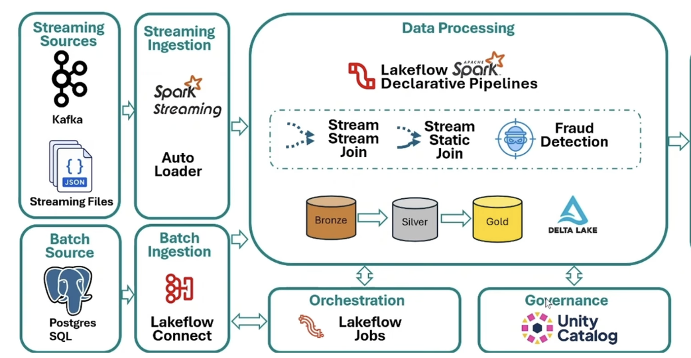
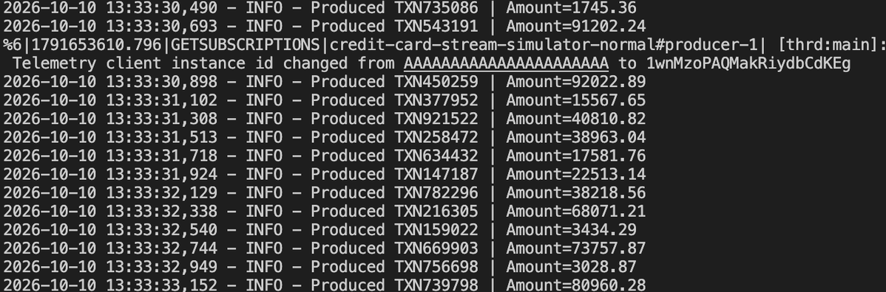
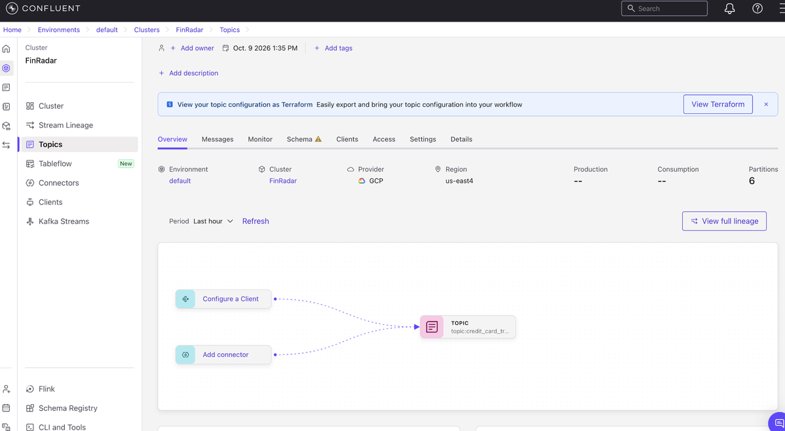
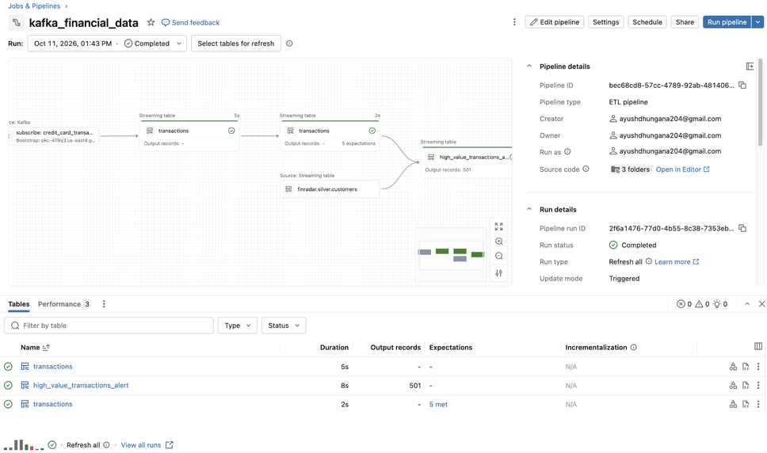
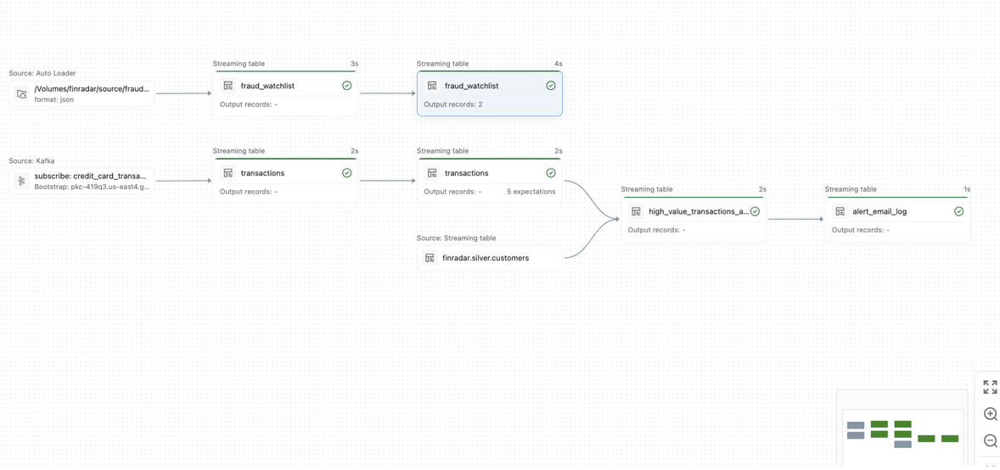
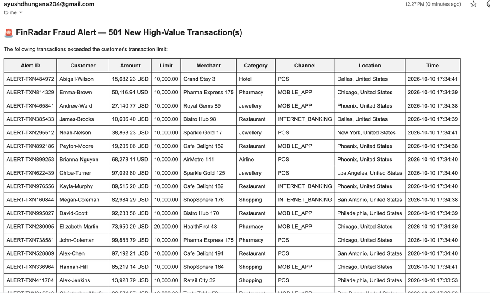

# FinRadar

FinRadar is a real-time credit-card transaction monitoring and fraud-alerting system. It combines a Python transaction simulator, Confluent Kafka, and Databricks Lakeflow Spark Declarative Pipelines (SDP) to ingest, refine, and analyze transaction and fraud-watchlist data. The pipeline produces high-value and watchlist-match alerts, with email notifications.

## At a glance

- **Transaction stream:** Python producers generate customer-linked transaction events and publish JSON messages to Kafka.
- **Watchlist stream:** A generator turns watchlist rows into JSON files; Databricks Auto Loader ingests newly arriving files.
- **Lakehouse processing:** Bronze tables retain incoming records, Silver tables parse and clean them, and Gold tables create alerts and time-window aggregates.
- **Notifications:** SDP append flows send alert email and append sent alert IDs and timestamps to a log table.
- **Customer context:** Static customer records enrich transaction alerts with names, email addresses, and transaction limits.

## Architecture



The runtime is organized into these stages:

1. **Generate events.** The producer creates customer and merchant fixtures and profile-driven transaction events. Separate producer scripts support normal traffic, a high-value transaction, and a transaction for a chosen card number.
2. **Publish and ingest.** Producers write transaction JSON to the configured Kafka topic. Databricks reads it as a stream. Watchlist JSON files are read from a Unity Catalog Volume with Auto Loader.
3. **Land raw data.** SDP defines Bronze streaming tables for Kafka transactions and watchlist files. Kafka metadata and ingestion timestamps are retained alongside the raw transaction value.
4. **Refine records.** Silver transforms parse transaction JSON against a schema, add Kafka lineage fields, normalize watchlist values, and declare data-quality expectations.
5. **Build alerts and metrics.** Gold definitions identify transactions exceeding customer transaction limits and cards matching the fraud watchlist. Other Gold tables calculate tumbling one-minute or sliding five-minute transaction counts.
6. **Notify.** Email append flows format new high-value or watchlist-match alerts, send them through SMTP, and write alert IDs and send times to `finradar.gold.alert_email_log`.

## Demonstration

The screenshots below show the supplied project running: Kafka producer output, the configured Kafka topic, successful SDP pipeline runs, and an alert email.

### Transaction producer



### Kafka topic



### Pipeline runs





### Alert email



## Repository layout

```text
.
├── 01_kafka_streaming_test.py              # Databricks batch and streaming Kafka smoke test
├── 02_setup_secret_scope.py                 # Databricks secret-scope setup example
├── 03_send_email.py                         # SMTP configuration smoke test
├── 04_autoloader_test.py                    # Auto Loader ingestion experiment
├── assets/                                  # Architecture and runtime screenshots
├── fraud_watchlist_generator/
│   ├── fraud_watchlist.csv                  # Example watchlist records
│   └── fraud_watchlist_data_generator.py    # Writes watchlist rows as Volume JSON files
├── kafka_financial_data/
│   ├── bronze/                              # Kafka and Auto Loader streaming sources
│   ├── silver/                              # Parsed transactions and cleaned watchlist
│   └── gold/                                # Alerts, aggregates, and email flows
├── kafka_producer/                          # Python simulator and Kafka producer scripts
└── static_customers_ingestion/              # Customer Silver table definition
```

## Requirements

### Local producer

- Python 3.10 or newer is recommended.
- A reachable Kafka cluster with a topic for transaction events. The producer config uses SASL/SSL with PLAIN authentication, as typically used with Confluent Cloud.
- Python dependencies listed in [`kafka_producer/requirements.txt`](kafka_producer/requirements.txt).

### Databricks pipeline

- A Databricks workspace with Spark Structured Streaming and Lakeflow Spark Declarative Pipelines support.
- A Kafka topic and credentials accessible from the workspace.
- Unity Catalog catalog/schema and a Volume for watchlist source files. The example paths use catalog `finradar`, schema `source`, and Volume subdirectories under `/Volumes/finradar/source/`.
- Customer source records available in `finradar.bronze.customers`; the included customer file defines a Silver transformation but does not include the Bronze ingestion job.
- SMTP credentials stored as Databricks secrets if email flows are enabled.

## Run the transaction producer

From the repository root, create an environment and install producer dependencies:

```bash
python -m venv .venv
source .venv/bin/activate       # Windows: .venv\Scripts\activate
pip install -r kafka_producer/requirements.txt
```

Create `kafka_producer/.env` with the Kafka cluster values:

```dotenv
BOOTSTRAP_SERVERS=your-bootstrap-server:9092
API_KEY=your-kafka-api-key
API_SECRET=your-kafka-api-secret
TOPIC_NAME=credit_card_transactions
TRANSACTIONS_PER_SECOND=5
FRAUD_PERCENTAGE=0.08
TOTAL_CUSTOMERS=1000
TOTAL_MERCHANTS=200
RANDOM_SEED=42
```

Keep `.env` out of version control and use credentials scoped to this demo. Configuration is loaded by `kafka_producer/config.py`; the bootstrap server, API key, and API secret are required. The other settings have defaults shown above.

Run a continuous stream of normal transactions:

```bash
cd kafka_producer
python producer_normal.py
```

Stop the continuous producer with `Ctrl+C`. It flushes its Kafka producer before exiting. The first run generates `data/customers.csv` and `data/merchants.csv` under `kafka_producer/` (the CSV files are regenerated when the producer starts).

Other producer scripts are:

```bash
python producer_fraud_transaction.py  # publishes one forced high-value transaction
python producer_fraud_card.py         # publishes one transaction for the configured test card
python consumer.py                    # prints messages from the configured Kafka topic
```

The two `producer_fraud_*.py` scripts each publish one message and exit; they are useful for triggering downstream examples. `producer_fraud_card.py` has a card number constant in the source that must match a card in the watchlist for a match alert. Producers send transaction fields as JSON and omit the simulator's internal `fraud_score` and `fraud_reason` fields.

## Configure Databricks

The notebooks and SDP source expect Kafka connection details in the Databricks secret scope `finradar_scope`, key `kafka_connection_details`. The secret value is a JSON object with this shape:

```json
{
  "bootstrap_servers": "your-bootstrap-server:9092",
  "topic": "credit_card_transactions",
  "api_key": "your-kafka-api-key",
  "api_secret": "your-kafka-api-secret"
}
```

Create the scope and populate this key using your workspace's approved secret-management process. `02_setup_secret_scope.py` is an illustrative Databricks notebook, not a general-purpose local setup command. Do not commit real tokens or credentials. The email examples expect `gmail_api_key` in the same scope; configure sender and recipient settings in the email flow source before using it.

For the watchlist branch, make the Unity Catalog Volume path `/Volumes/finradar/source/fraud_watchlist/source_data/` available. In Databricks, run `fraud_watchlist_generator/fraud_watchlist_data_generator.py` to convert the included CSV rows to individual JSON files in that location. The generator references a workspace-specific CSV path; update it to the location where you uploaded the CSV. The Auto Loader Bronze definition consumes JSON files from this Volume.

Upload or sync the folders `kafka_financial_data/` and `static_customers_ingestion/` as the source for an SDP pipeline, and configure the pipeline's catalog/schema and permissions for the names used in the code. Run the pipeline after the Kafka producer is publishing and the source data is ready. `01_kafka_streaming_test.py` and `04_autoloader_test.py` are standalone ingestion experiments; they are not required when using the declarative pipeline definitions.

## Tables and outputs

| Layer | Table | Purpose |
|---|---|---|
| Bronze | `finradar.bronze.transactions` | Kafka key/value, topic, partition, offset, broker timestamp, and ingestion timestamp. |
| Bronze | `finradar.bronze.fraud_watchlist` | Watchlist JSON loaded from the Volume with Auto Loader. |
| Silver | `finradar.silver.transactions` | Parsed transaction fields plus Kafka lineage; required identifiers have drop expectations and amount has a quality expectation. |
| Silver | `finradar.silver.fraud_watchlist` | Normalized watchlist IDs, entity IDs, risk levels, actions, and parsed effective dates. |
| Silver | `finradar.silver.customers` | Customer attributes used to enrich alerts; sourced from the separately provisioned customer Bronze table. |
| Gold | `finradar.gold.high_value_transactions_alert` | Transactions whose amount exceeds that customer's `transaction_limit`. |
| Gold | `finradar.gold.fraud_card_alert` | Transactions whose card number matches a watchlist entity ID. |
| Gold | `finradar.gold.transaction_count_by_minute` | Tumbling one-minute transaction counts. |
| Gold | `finradar.gold.transaction_count_by_minute_sliding_window` | Five-minute counts updated at one-minute intervals. |
| Gold | `finradar.gold.alert_email_log` | Alert IDs and timestamps for email notifications sent by append flows. |

## Fraud and alert behavior

The local simulator's `FraudEngine` scores a generated transaction using signals including high value, a new device, high-risk or blacklisted merchant, international location, rapid transaction velocity, low-value card testing, and an impossible New York/Los Angeles travel pattern. `FRAUD_PERCENTAGE` controls the chance that the simulator forces a fraud reason when normal rules do not produce one. This score is for simulator behavior: producer payloads remove the score and reason before sending to Kafka.

The Databricks Gold alerts implement separate rules. High-value alerts compare each transaction amount to the customer's `transaction_limit`. Card alerts join transaction card numbers to watchlist `entity_id` values (with five-minute event-time watermarks). These alert tables drive the corresponding email flows when those flows are included in the deployed pipeline.

## Development notes

- The files use Databricks notebook and Lakeflow SDP APIs such as `spark`, `dbutils`, and `pyspark.pipelines`; they are intended to run in a configured Databricks workspace, not as ordinary local Python scripts.
- `01_kafka_streaming_test.py` contains both a Kafka batch read and an `availableNow` streaming write useful for validating connectivity and parsing.
- The watchlist generator writes one JSON file per row and waits between writes, which makes new-file ingestion observable during a demo.
- Email append flows perform SMTP sends inside `mapInPandas`. Ensure network access and secret availability in the pipeline environment before enabling them.
- The sample screenshots document a demonstration run and its configuration; they are illustrative and do not represent live service status.